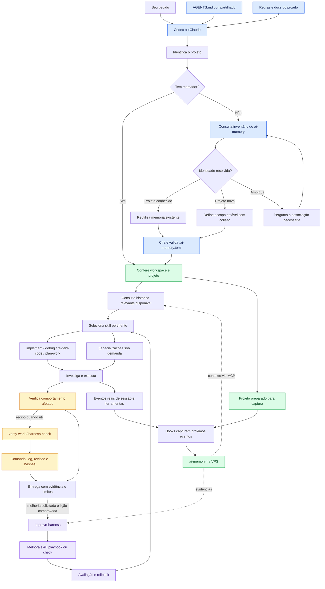

# Personal Agent Harness

**Regras compartilhadas, contexto sob demanda, memória entre sessões e melhoria baseada em evidências.**

Harness pessoal para trabalhar com **Codex e Claude** em diferentes projetos.
Aqui, “harness” significa a combinação de instruções, skills, ferramentas,
hooks e verificações que cerca o agente. Não é um modelo novo nem um framework
que substitui os agentes.

> Estado documentado em **3 de novembro de 2026**. Núcleo instalado nos dois
> agentes; ai-memory 3.3.2 no servidor existente. As limitações de validação
> estão em [Estado e evidências](docs/validation.md).

## Mapa completo

O GitHub renderiza o Mermaid abaixo como diagrama. Clique para ampliar.
A ausência de marcador aciona o braço de inicialização conduzido pelo agente;
não significa abandonar a memória.



## Entenda as peças

| Peça | Responsabilidade | O que não garante |
|---|---|---|
| AGENTS.md | Escopo, autonomia, regras gerais e roteamento | Execução mecânica de cada instrução |
| Skill / playbook | Procedimento carregado quando pertinente | Um ritual obrigatório para toda tarefa |
| MCP | Interface para consultar e operar ferramentas do servidor | Que sessão antiga atualize seu catálogo sozinha |
| Hook | Comando disparado por eventos do agente | Interpretação independente da identidade do projeto |
| .ai-memory.toml | Associação do checkout a workspace/projeto | Que eventos anteriores sejam importados |
| ai-memory | Histórico, conhecimento e continuidade | Correção atual de todo conteúdo recuperado |
| verify-work | Execução e atualidade de evidência delimitada | Cobertura completa ou prova de produção |
| improve-harness | Incorporação de lições nos procedimentos | Reescrita global autônoma em qualquer conversa |

## Como navegar

- [Arquitetura e decisões](docs/architecture.md): responsabilidades e porquês.
- [Operação](docs/operation.md): memória, hooks, projetos novos e retomada.
- [Melhoria](docs/improvement.md): como experiências viram procedimentos melhores.
- [Estado e evidências](docs/validation.md): o que foi e não foi verificado.
- [Fontes](docs/sources.md): referências e distinção entre upstream e escolhas locais.
- [Núcleo versionado](harness/): regras e sete skills centrais, incluindo o runner.

## Estrutura

```text
personal-agent-harness/
├── README.md                  # Visão geral e mapa renderizado
├── AGENTS.md                  # Instruções deste repositório
├── docs/
│   ├── architecture.md        # Estrutura instalada e decisões
│   ├── architecture.mmd       # Fonte independente do mapa principal
│   ├── operation.md           # Uso e inicialização de projetos
│   ├── improvement.md         # Dois ciclos de aprendizado
│   ├── validation.md          # Evidências e limites
│   └── sources.md             # Referências primárias
├── harness/
│   ├── AGENTS.md              # Snapshot da fonte compartilhada
│   └── skills/                # Sete skills centrais e suas referências
└── tests/                     # Regressões do runner verify-work
```

## Versionamento e reprodução

`harness/` contém um **snapshot explícito** do núcleo instalado. A fonte ativa
na máquina continua em `~/.agents/`. Não há sincronização automática em nenhuma
direção. Para promover uma alteração, revise o diff, valide os casos afetados,
preserve a versão anterior e aplique aos caminhos da instalação conscientemente.

Este repo não inclui credenciais, endereços privados, transcrições, dados da
wiki ou plugins de terceiros. Também não instala servidor nem modifica a home
por conta própria. Consulte a documentação upstream para instalação do ai-memory.

Para testar o runner com Python 3:

```bash
python3 -m unittest discover -s tests
```

O runner pode ser usado diretamente, sem instalar o atalho `harness-check`:

```bash
python3 harness/skills/verify-work/scripts/check.py --help
```
