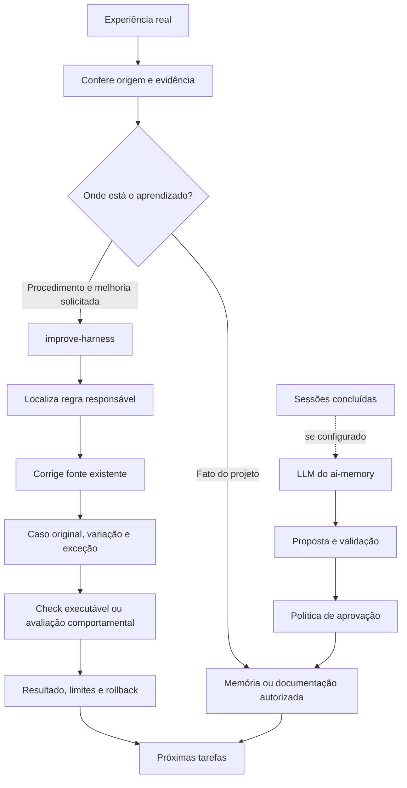

# Melhoria com evidência

Há dois mecanismos diferentes. `improve-harness` orienta mudanças em arquivos
de regras, skills e checks. O auto-improvement do ai-memory propõe alterações
em páginas da wiki; não modifica automaticamente esses arquivos locais.

## Exemplo real desta construção

O harness inicialmente deixava de capturar quando faltava marcador. Essa
proteção evitava mistura de projetos, mas não preparava projetos novos. A
correção adicionou identificação, consulta ao inventário, reutilização/criação
do marcador e verificação. A política de captura foi preservada.

A evidência atual cobre os dois agentes com/sem marcador e os escopos
resolvidos. Ainda não demonstra que um agente novo sempre executará todo o
onboarding corretamente. Essa distinção evita chamar instrução de automação
mecânica ou check de configuração de ganho comportamental.

## Gates

O runner verify-work registra comando, exit code, timeout, log, revisão Git e
hashes antes/depois. `verify` rejeita evidência falha ou obsoleta. Não seleciona
testes sozinho, não é uma assinatura criptográfica contra falsificação de
recibos e não intercepta toda ação do agente.

No ai-memory, o avaliador de auto-improvement é separado e opcional. O scorer
estrutural confere formato; um scorer específico pode avaliar propostas de
regras/procedimentos. Um recibo local do harness não configura esse gate no
servidor automaticamente.

## Autonomia e aprovação

O pedido de melhorar o harness autoriza a mudança pertinente. Não cria licença
permanente para reescrever regras em qualquer tarefa. Durante trabalho comum,
o agente pode sinalizar uma lição sem ampliar o escopo.
O procedimento completo está em [improve-harness](../harness/skills/improve-harness/SKILL.md).
O ai-memory upstream auto-aprova propostas válidas por padrão quando seu ciclo
com LLM está configurado; revisão humana é configurável. A política efetiva da
instalação precisa ser verificada antes de ativar esse ciclo.
