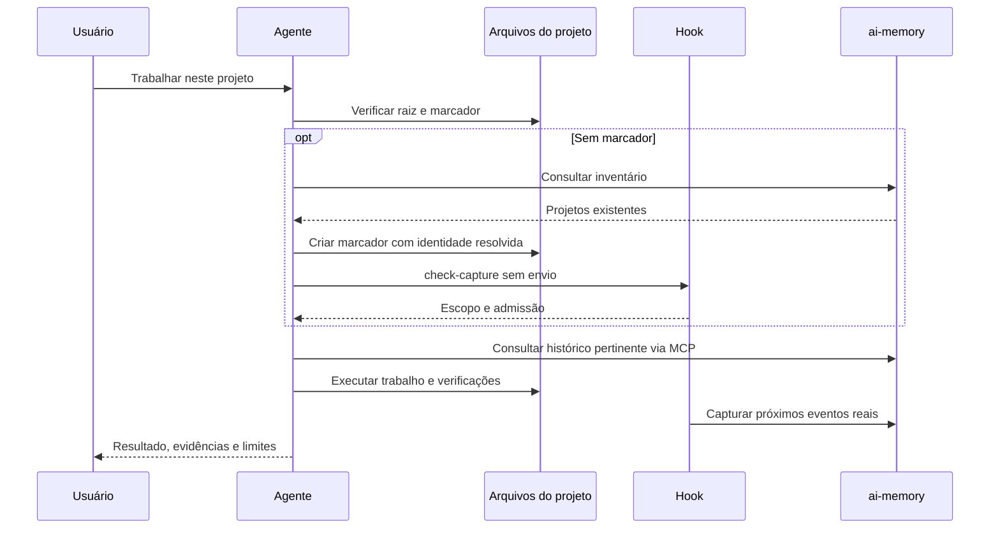

# Operação e continuidade

## Começo do trabalho

O agente lê instruções pertinentes e identifica a raiz efetiva. Se há marcador,
confere o par workspace/projeto; se não há, consulta `ai-memory list-projects
--json`. Reutiliza associação inequívoca ou prepara escopo de projeto realmente
novo. Ambiguidade exige somente a decisão que falta. Falha de rede não significa
inventário vazio e não autoriza criar memória duplicada.

A regra completa está em [project-onboarding.md](../harness/skills/ai-memory/references/project-onboarding.md).
Home, workspace agregador, artefatos e conversas avulsas não viram projetos.
O marcador é validado com `hook --check-capture`, que não envia eventos.

Exemplo ilustrativo, não configuração para copiar sem identificar o projeto:

```toml
workspace = "default"
project = "owner/example-project"
project_strategy = "repo-root"
```

## Hook, MCP e marcador

Um hook é executado quando ocorre um evento: início/fim de sessão, mensagem ou
uso de ferramenta. Sua função é capturar eventos permitidos. MCP é a interface
que o agente chama deliberadamente para buscar memória e executar operações.
O marcador associa essas atividades ao projeto correto.



A captura está em allowlist. Criar um marcador prepara próximos eventos, mas
não reenvia SessionStart nem mensagens antigas. O escopo novo pode aparecer
no servidor apenas quando houver captura. Nunca produza página fictícia ou
session_id inventado para simular sucesso.

## O que fica salvo

O histórico já existente permanece disponível. `backfill_on_start=false`
impede a varredura automática de conversas antigas locais; não apaga memória.
Captura de resposta final não foi habilitada nesta configuração. Credenciais
ficam fora do repositório e não devem ir em argumentos, exemplos ou logs.

## Retomar e atualizar

Leia contexto já injetado antes de repetir consultas. Liste handoffs sem
consumir; aceite apenas ao retomar o trabalho correspondente e se o hook não
o entregou. Clientes estáticos enviam workspace e project explicitamente.
Após upgrade do servidor, reconecte o MCP ou abra uma sessão nova para obter
schemas atuais. Uma ferramenta instalada no servidor pode estar ausente do
catálogo de uma sessão antiga.

## Diagnóstico

Diferencie: marcador válido; captura admitida; evento entregue; página
consolidada; memória útil recuperada. Um estágio não comprova os demais.
Sessão marcada aberta no servidor não prova processo vivo. Hooks instalados
no Codex também precisam estar confiáveis. Confira sem consumir handoffs.
